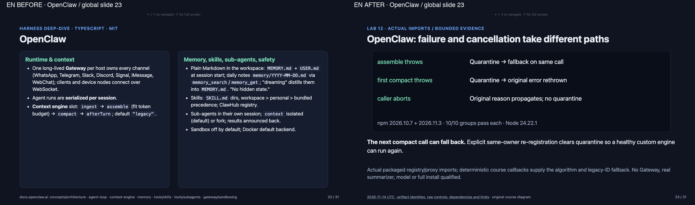
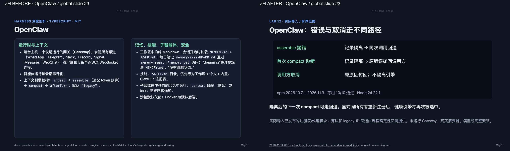

# OpenClaw context-registry review — 2026-11-14 UTC

Deep-dive global slide23 (local2of10) only; both EN/ZH remain global22–31. Original OpenClaw overview is retained in hidden notes. Distinct assembly/compact/abort behavior is measured against both pinned npm cohorts.

[Execution note](../../../llm-agentos-course/references/openclaw_context_runtime_2026_11.md) records actual imports and callback/full-Gateway limits.
