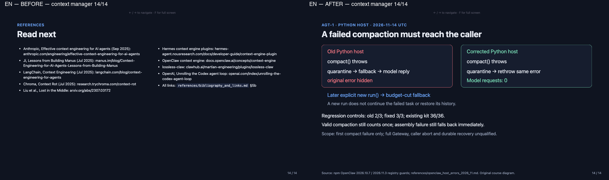
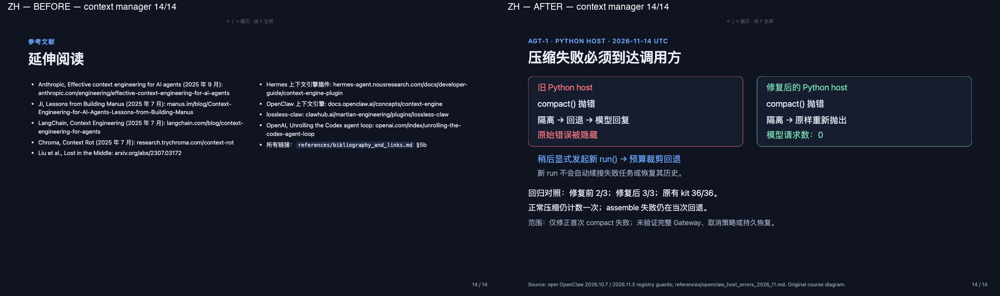

# Python OpenClaw host compaction errors — 2026-11-14 UTC

Context-manager slide14, 1280×720 native captures in each language. Each sheet: before on left, after on right. Original reference lists remain in hidden reading notes. Error visibility is a Python host regression result; full Gateway, cancellation and durable recovery remain unqualified.

See the [executed note](../../../llm-agentos-course/references/openclaw_host_errors_2026_11.md).
