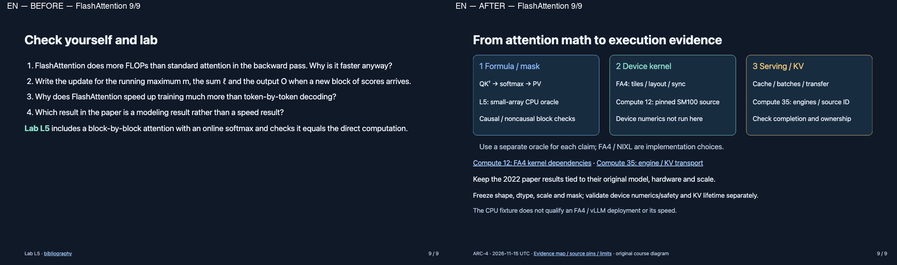
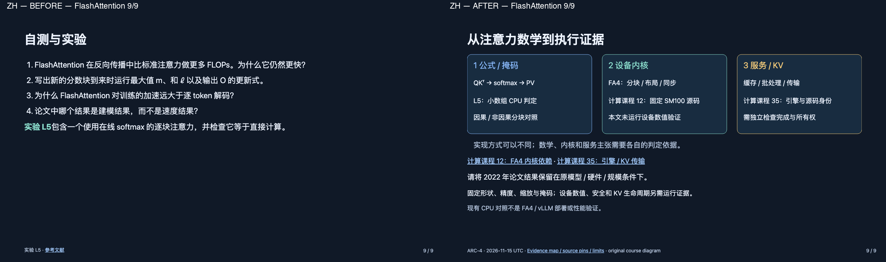

# ARC-4 attention execution handoff — 2026-11-15 UTC

Architecture deck14 slide9, native1280×720 captures. Before on left, after on right. Both languages retain9 slides; old questions remain in notes and paper-result slides1–8 stay unchanged. The diagram links the corresponding compute12/35 language twins and separates mathematical, device and engine/transport evidence.

[Primary-source record and limits](../../../llm-transformer-architecture-course/references/attention_execution_links_2026_11.md).
