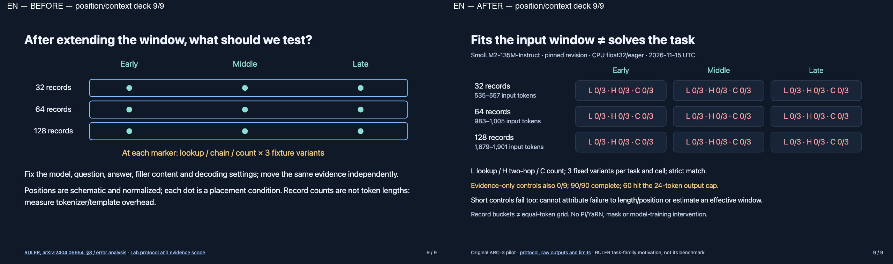
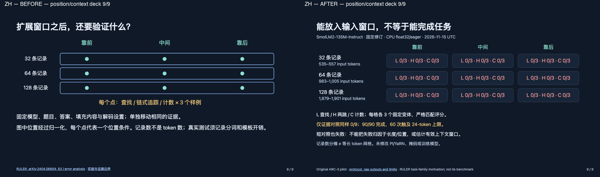

# ARC-3 actual model pilot — 2026-11-15 UTC

Deck10 slide9, native1280×720 captures. Before on left, after on right. Earlier teaching grid/questions remain in hidden reading notes; slide count stays9 in both languages. The measured result is strict0/81 plus0/9 short controls; it does not identify a length/position effect or validate PI/YaRN.

[Executed evidence and limits](../../../llm-transformer-architecture-course/references/context_model_pilot_2026_11.md).
