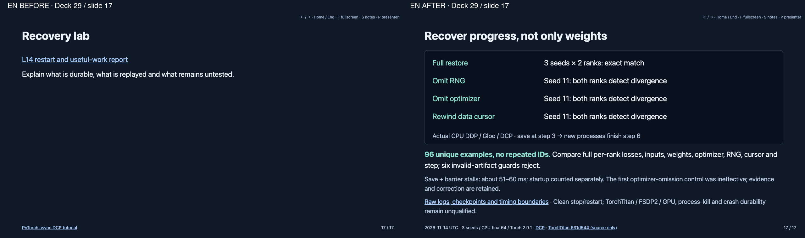
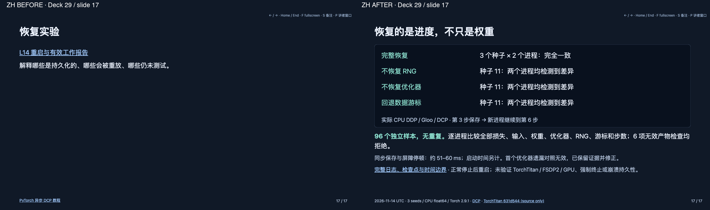

# Distributed resume pilot review — 2026-11-14 UTC

Deck29 slide17 only, synchronized English/Chinese, 17 slides per deck. Existing prompt remains in hidden notes. Original inline diagrams are outside the unchanged managed figure set.

[Source/execution note](../../../llm-compute-systems-course/references/distributed_resume_2026_11.md) retains scope, initial control failure/correction, raw measurements and remaining target gates.
