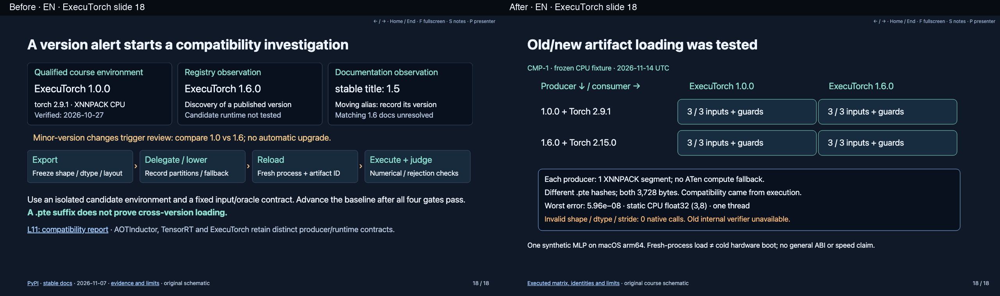
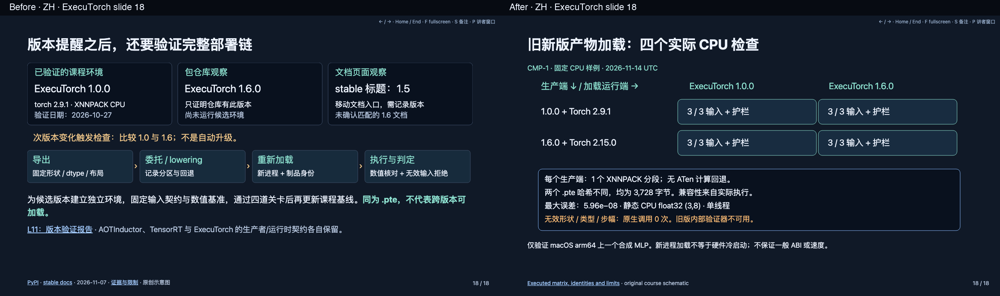

# ExecuTorch CPU compatibility review

Deck 23 slide 18: before left / after right. Earlier monitoring schematic retained in hidden notes.

[Executed matrix, package/source identities, raw observations and limits](../../../llm-compute-systems-course/references/executorch_cpu_compatibility_2026_11.md).
