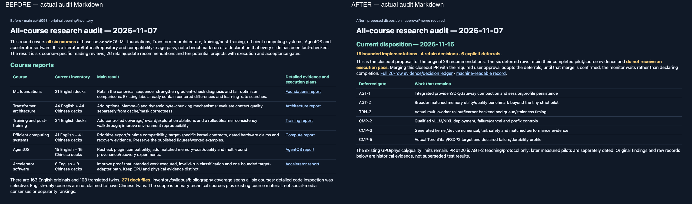

# Research-audit closeout review — 2026-11-15 UTC

Before/after captures render the actual Markdown: the pre-edit audit opening/course inventory at main `ca4d098`, and the new current-disposition section with six explicit deferral gates. These are document captures, not new slide/model/device results. No translated deck changes are involved.

[Full 26-row decision/evidence record](../../research-audit-2026-11-15-closeout.md) · [machine-readable dispositions](../../research-audit-2026-11-15-closeout.json).
