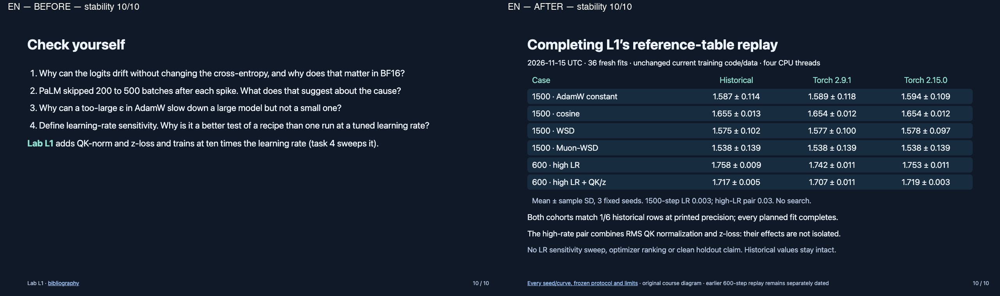

# Remaining L1 reference tables — 2026-11-15 UTC

Deck03 slide10, native1280×720 captures; before on left, after on right. The earlier stability questions remain in hidden notes. No translated twin exists; deck count remains10. The diagram reports all six preset historical/current rows and the combined-intervention/rounding limits.

[Full executed evidence](../../../llm-training-course/references/l1_remaining_tables_2026_11.md).
