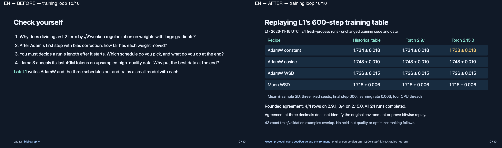

# L1 600-step table replay — 2026-11-15 UTC

Deck01 slide10, native1280×720 captures; before on left, after on right. No translated twin exists. Original closing questions remain in notes, with10 slides unchanged. The result table is three-seed mean±sample SD, not an optimizer ranking or historical-environment identification.

[Executed evidence and limits](../../../llm-training-course/references/l1_table_replay_2026_11.md).
