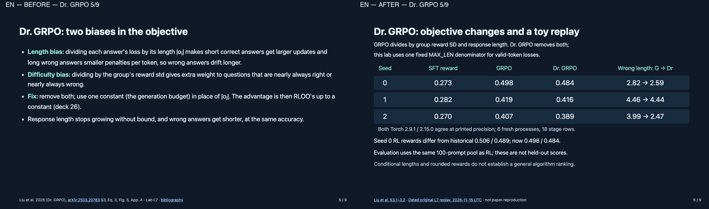

# L7 unchanged demo replay — 2026-11-15 UTC

Deck28 slide5, native1280×720 captures; before on left, after on right. The earlier paper explanation remains in hidden notes. No translated twin exists; deck count remains9. The new diagram separates objective normalization from the shared-training-pool toy replay and historical printed mismatch.

[Executed evidence](../../../llm-training-course/references/l7_demo_replay_2026_11.md).
