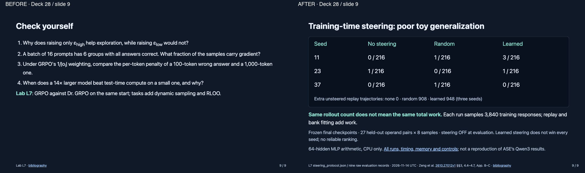

# Training-time steering review — 2026-11-14 UTC

Deck28 slide9 only; nine slides retained. The original questions remain in hidden notes. This course has no translated decks. Original diagram reports every seed, poor generalization and additional replay work.

See the [evidence note](../../../llm-training-course/references/steering_ablation_2026_11.md) for frozen design, raw runs and limits.
