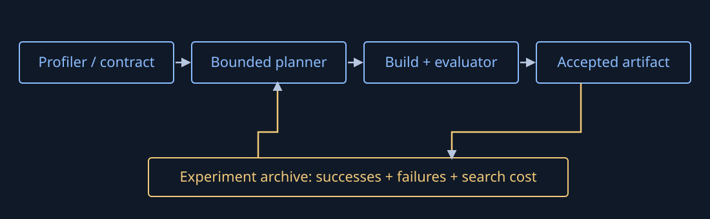

# Potential LLM systems projects — separate specifications

Prepared 2026-10-27. These are **independent project candidates**, not promises to build them all or evidence that their improvements have been measured. They extend the course's [optimization map](../notes/optimization_techniques.md). A project can use a small common evaluator without waiting for a universal framework.

The most practical entry points are P01 (measurement), P02 (bounded serving configuration), P03 (agent/cache policy) and P06 (compiler/backend decisions). P08/P09 add code generation or learning only after the evaluator is reliable. Existing [vLLM auto-tuning](https://github.com/vllm-project/vllm/blob/main/benchmarks/auto_tune/README.md), [TileLang tools](https://www.tilelang.com/tools/index.html), [FlashInfer-Bench](https://bench.flashinfer.ai/) and [agentic-api](https://github.com/vllm-project/agentic-api) are baselines to reuse/compare, not capabilities to claim as new.

## Candidate catalogue

| ID | Independent project | Initial deliverable | Minimum experimental hardware | Course connection |
|---|---|---|---|---|
| P01 | Cross-engine inference benchmark | Matched arrival replay, raw events, comparability ledger | CPU-capable engine first; GPU for target claims | L1, L7–L8 |
| P02 | Serving configuration autopilot | Budgeted search with SLO/quality constraints | One supported inference GPU | L7–L8 |
| P03 | Agent lifecycle / KV policy evaluator | Tool-wait replay and retain/offload/recompute comparison | CPU model; real engine/GPU for validation | L7, L10 |
| P04 | KV handoff and split-serving testbed | Compatible transfer plus equal-resource comparison | Two supported devices and measured link | L8 |
| P05 | DeepInfer service integration study | Interface audit, bounded service adapter and failure tests | Supported SM100/Ascend setup for real execution | L9, L7–L8 |
| P06 | Compiler and library path selector | Eager/Inductor/AOT/vendor-path decision report | CPU first; target GPU for vendor claims | L2, L4, L11 |
| P07 | Kernel abstraction comparison lab | Same operator in two DSLs plus library baseline | Supported CUDA or ROCm GPU | L3–L5 |
| P08 | Verified kernel-search agent | Bounded candidate edits, evaluator and rejection archive | One supported GPU | L3–L5, deck 32 |
| P09 | Inference Evolution Controller | Cross-layer planner with reusable experiment history | One engine/device first | Deck 32; capstone |
| P10 | Precision and quality gate | Recipe/packing/error/quality/fallback evaluator | CPU numerical path; eligible target for acceleration | L6 |
| P11 | MoE routing and skew workbench | Route/dispatch/compute/combine breakdown | One GPU; multiple for exchange claims | L4, L9 |
| P12 | Training layout / overlap explorer | Feasible plans plus fixed-batch update/peak validation | CPU accounting; 2–8 GPUs for measurements | L12–L13 |
| P13 | Recoverable-training benchmark | Controlled interruption and useful-work accounting | CPU first; cluster extension | L14 |
| P14 | Export and edge-backend optimizer | Producer/loader/partition/cold-start comparison | One supported CPU/edge target first | L11 |
| P15 | NVIDIA/AMD portability dossier | Mechanism/support matrix and revalidated experiment | Target-specific NVIDIA and/or AMD access | L15 |
| P16 | Host-to-device pipeline optimizer | Measured input/transfer/dispatch intervention | CPU + one GPU for overlap claims | L1 |
| P17 | Adaptive speculative-decoding evaluator | Correct draft/verify/correct plus load-aware policy | CPU probability model; real draft/target pair on GPU | L10 |
| P18 | Domain-transfer deployment study | One vision model and target with domain metrics | One supported device; optional second target | Optional extension to L11 |
| P19 | Reproducible optimization workbench | Shared manifests, isolated adapters and result archive | CPU development; target workers optional | Shared infrastructure |
| P20 | Rollout/trainer resource-balance study | Fixed-budget inference/post-training stage accounting | CPU model; multi-GPU for measured loop | L14, L10, L15 |

## Common specification contract

Each candidate must name: target model/revision, hardware, software, input/shape/arrival distribution, dtype and numerical/task-quality contract, baseline, bounded search space, raw metrics and failure accounting. Keep CPU references, analytical estimates, source inspection and target measurements explicitly distinct.

A result record contains an immutable experiment ID; source/config/environment hashes; workload/train/evaluation split; seed; candidate implementation; build and correctness outcomes; warmup and timing scope; raw samples/events; peak allocated/reserved memory; failure/timeout/rejection counts; and the decision with reasons. Preserve failed builds and incorrect candidates, not just winners. Record power/energy only if a real meter/telemetry boundary is available.

Correctness precedes timing. For fixed-computation optimizations compare outputs and required gradients; for changed precision/semantics add held-out task quality. For serving compare the same offered arrivals and resources, define TTFT/TPOT/goodput and include unfinished work. For training preserve effective batch, data coverage and progression. A faster microkernel is an intermediate result; measure the system boundary the proposal claims to improve.

Each project has three milestones: **M1** reproducible baseline and negative controls; **M2** one bounded intervention with an adverse case; **M3** held-out evaluation, reproducibility package and go/no-go report. A well-explained null result is valid research evidence. It does not satisfy a product claim of speedup.

## P01 — Cross-engine inference benchmark

**Question:** Which engine meets a fixed workload's quality/latency constraints under the same resource budget?

**MVP:** one shared model/tokenizer/precision supported by two engines; streaming event capture, arrival replay and a comparability report. Start with short/long prompts and cold/shared/mismatched prefixes. Record incompatible features instead of silently changing conditions.

**Baseline and acceptance:** compare each adapter against the engine's own benchmark/counters. Account for every offered request, validate event parsing with controlled failures, and reproduce token/latency calculations from raw events. Do not require identical sampled strings as the sole quality gate. No engine ranking if model/precision/resource conditions differ materially.

**Boundary:** a benchmark, not a new serving engine. Main risks are instrumentation perturbation, hidden tokenizer/prompt differences and closed-loop load bias. Deliver CLI, engine manifests, replay fixtures, raw results and a report.

## P02 — Serving configuration autopilot

**Question:** Can a bounded search find a better SLO-feasible configuration at lower tuning cost than existing search?

**MVP:** one vLLM release, one GPU/model and three arrival distributions. Search only supported concurrency/token-budget/cache settings; reject infeasible/OOM candidates explicitly. Reuse P01-style metrics or an independent minimal evaluator.

**Baseline and acceptance:** compare current defaults, vLLM auto-tune and random/grid search under equal trial/GPU-time budgets. Separate tuning and held-out workloads. Report quality, p95/p99 latency, goodput, peak memory, compilation/startup and search GPU-hours. Show a Pareto frontier rather than one unqualified winner.

**Boundary:** no kernel rewriting or live production policy changes in MVP. Stop on a fixed trial/time budget; export a pinned configuration and rollback manifest. Novelty must be established against the existing tuner, not merely a web interface.

## P03 — Agent lifecycle and KV policy evaluator

**Question:** When does retaining, offloading or recomputing idle agent state improve task completion under pressure?

**MVP:** tool-wait/branch/cancel/resume traces, exact prefix identity checks, one real engine adapter where supported, and a simulator kept clearly separate. Policies: idle LRU baseline, bounded TTL and measured transfer/recompute choice.

**Baseline and acceptance:** preserve model/adapter/token identity and ownership, include early mismatches and one shared-owner cancellation, and validate pressure/failed-resume handling. Report avoided/recomputed tokens, state byte-seconds, transfer bytes/time, resume TTFT, task completion and fairness. Recheck [vLLM RFC #52113](https://github.com/vllm-project/vllm/issues/52113) and existing agentic-api work; do not treat proposed hint fields as installed APIs.

**Boundary:** application lifecycle intent does not own physical engine block pointers. No semantic-response-cache substitution for KV correctness. Deliver trace schema, policy evaluator, engine capability table and null/adverse results.

## P04 — KV handoff and split-serving testbed

**MVP:** one supported model/layout/connector across two devices; verify state compatibility, handoff completion, cancellation and one transfer failure. Compare two colocated workers with one prefill + one decode worker under equal total resources.

**Acceptance:** measure transfer and queue costs, not peak-link estimates; preserve generation/numerical contract; report offered/completed/failed/unfinished requests and both latency SLOs. Include a workload where handoff overhead outweighs interference savings. Deliver deployment manifests, raw stage events and an end-to-end report. Excludes universal cross-engine KV serialization.

## P05 — DeepInfer service integration study

**MVP:** first audit the pinned release's model/target, engine API, internal state ownership and external service gaps. Only then design a minimal streaming service adapter with cancellation, bounded queues, health checks and observability.

**Acceptance:** source findings must identify actual symbols/interfaces and separate offline capability from external service components. Real execution requires the release's supported SM100 or Ascend environment; without it, deliver an interface feasibility spec with “not run” cells, not a purported working service. Compare existing service frameworks before implementing duplicate features. Excludes assuming generic NVIDIA, Rubin, AMD or laptop compatibility.

## P06 — Compiler and library path selector

**MVP:** one small transformer block plus one workload-critical operator, fixed and dynamic shapes, eager/Inductor/AOT paths and an eligible vendor alternative. Trace graph breaks, dispatch and conversion/packing boundaries.

**Acceptance:** same output/gradient contract where applicable; cold compile/load separated from warm execution; held-out shapes and unsupported-contract rejection. Compare a measured library baseline before considering code generation. Deliver artifacts, loaders, environment locks, raw timings and a per-shape decision table. Excludes a universal optimal compiler or automatic cuBLAS-to-other-hardware conversion claim.

## P07 — Kernel abstraction comparison lab

**MVP:** reduction and ragged/irregular GEMM cases in two supported paths such as Triton/TileLang/CUDA, with current library baselines. Inspect tile/layout/pipeline controls and generated execution.

**Acceptance:** tails, noncontiguity where supported, numerical edge cases, required gradients and memory/synchronization diagnostics. Include compilation/tuning cost and shapes where the custom path loses. Deliver editable source, target-specific build manifests and measurements. CUDA Tile, CuTe DSL and TileLang are distinct candidates; source portability does not establish performance portability.

## P08 — Verified kernel-search agent

**MVP:** restrict edits to one operator template and a finite configuration set. Run candidates in isolated bounded workers, validate correctness before unprofiled timing and archive every candidate/decision. A generated candidate never bypasses the evaluator.

**Acceptance:** compare hand-written/default implementations, existing autotuning and a [FlashInfer-Bench](https://bench.flashinfer.ai/)-compatible evaluation where applicable. Use held-out shapes and deliberately incorrect candidates to prove rejection. Report final speed, compile attempts, failures, GPU-hours and human interventions. Excludes arbitrary whole-repository edits or automatic production promotion.

## P09 — Inference Evolution Controller

**Question:** Can history-guided **choice of optimization layer** reduce total search cost on held-out tasks, beyond existing parameter/kernel tuning?

**Architecture:** environment/workload profiler → bounded planner → typed candidate adapters → independent build/correctness/performance evaluator → immutable experiment archive. The planner reads past successes and failures and proposes the next action; the evaluator owns acceptance. Candidate families begin with serving parameters and compiler choices, then add an explicitly supported kernel family. Libraries, graph compilation and kernels are alternatives, not a mandatory serial pipeline.

**MVP:** one engine, one device family, one model and three workload regimes. Compare no-history random/grid search, an existing tuner and history-guided ranking under the same wall/GPU-time budget. Hold out at least one shape/arrival regime. Candidate changes that alter precision or semantics require their own quality gate.

**Acceptance:** reproduce all accepted results from source/environment hashes; reject injected wrong candidates; report performance-versus-search-budget curves and negative transfer. Demonstrate either a predeclared reduction in search cost at matched final performance, or improved feasible performance at matched search cost. Select numerical targets after a baseline pilot, before the held-out run. No claim of new capability merely from composing existing tools.

**State machine:** proposed → built/failed → correct/incorrect → measured/timeout → accepted/rejected → revalidated on deployment target. Composition of accepted changes creates a new candidate. Stop when the search budget expires, no feasible candidate remains, or measured improvement falls below the predeclared uncertainty/benefit threshold. Keep the last known-good artifact.

**Non-goals:** retraining the LLM, implementing CUDA from scratch, supporting every accelerator, and unconstrained self-modification. A new hardware target needs its own compiler/runtime/library capability assessment. Deliver controller/evaluator interfaces, experiment database schema, baseline adapters, reproducibility report and a narrow next-stage decision.

## P10 — Precision and quality gate

**MVP:** one supported weight/activation/KV recipe, a reference path and calibration/evaluation split. Account for packed payload, scales, padding, conversion, workspace and fallback.

**Acceptance:** finite output/gradient checks where relevant, predeclared reconstruction/task-quality bounds, long-context or outlier adverse cases, and actual kernel dispatch before an acceleration claim. Distinguish AMP, PTQ, QAT and KV precision experiments. Deliver a recipe dossier, quality tests and end-to-end byte/time report; excludes assuming equal bit width means equal format or quality.

## P11 — MoE routing and skew workbench

**MVP:** fixed top-k route fixtures and local permute/GEMM/combine correctness, then one eligible distributed dispatcher. Uniform, hot-expert and empty-expert cases share the same total assignments.

**Acceptance:** preserve route/gate/drop semantics and required backward behavior; time routing, exchange, expert compute and combine separately, then the full step/request. Compare supported grouped/library paths and report maximum-rank time. Deliver load fixtures, phase trace and bottleneck diagnosis. Excludes changing routing quality to manufacture a speedup.

## P12 — Training layout and overlap explorer

**MVP:** feasible-state accounting plus two measured DP/TP/PP/CP layouts on available devices, or a clearly labeled analytical first milestone. Track persistent, transient, activation and workspace state separately.

**Acceptance:** fixed effective batch/data progression, numerical updates, peak memory, placement and exposed collectives. Compare an existing TorchTitan/Megatron configuration rather than an unrealistic straw baseline. Include a layout that fits persistent state but fails the transient budget. Deliver configuration/source dossier and feasibility/performance report; excludes inferring cluster speed from a mesh product.

## P13 — Recoverable-training benchmark

**MVP:** interruption/resume of model, optimizer, scheduler, RNG and data/sampler position, including a missing-state negative control. Begin with CPU, then actual process/cluster failures on supported storage.

**Acceptance:** compare resumed loss/update/data trajectory under declared determinism; test incomplete snapshot visibility and completion publication. Report useful tokens over total time, lost/repeated work and restore cost. Deliver checkpoint format manifest and failure report. Excludes equating local rename with distributed durable commit.

## P14 — Export and edge-backend optimizer

**MVP:** one supported target, export/compile/load path and backend partition report; add a second target only after the first reproduces. Evaluate AOTInductor, ExecuTorch or a vendor SDK according to the actual model/device.

**Acceptance:** numerical/quality equivalence, shape guards, producer/loader versions, artifact size, memory, cold start and warm latency. Measure CPU fallback/transfer boundaries. Compare the target's default optimized path and existing SDK tooling, not eager alone. Deliver artifacts and compatibility matrix; excludes treating `.pt2`, `.pte`, `.ptd`, GGUF and saved KV sessions as interchangeable.

## P15 — NVIDIA/AMD portability dossier

**MVP:** map one training and one serving dataflow to NVIDIA and AMD responsibilities, then reproduce one small optimization on each available target. Rubin remains a source-based case study until actual target access/support exists.

**Acceptance:** cite primary hardware/library facts with dates; distinguish advertised peak, analytical budget and measured result. Recheck datatype/layout/kernel/collective support and include conversion/porting work. Deliver source-linked dossier plus target-specific results; no cross-vendor performance ranking without matched workload/resource/cost boundaries.

## P16 — Host-to-device pipeline optimizer

**MVP:** trace one input/transfer/dispatch bottleneck; change one of locality, prefetch depth, pinning or batching. Model buffer ownership and backpressure explicitly.

**Acceptance:** validate data order/output, compare unprofiled end-to-end throughput and tail latency, inspect one confirming trace, and include a queue-pressure adverse case. Deliver pipeline diagram, memory/lifetime ledger and before/after evidence. Excludes assuming nonblocking APIs guarantee overlap.

## P17 — Adaptive speculative-decoding evaluator

**MVP:** exact categorical accept/reject/correction reference, then one real draft/target configuration with fixed sampling semantics. Compare speculation off/fixed/adaptive under low/high acceptance and low/high load.

**Acceptance:** verify the intended distribution/correction logic and cache rollback; report accepted tokens, draft/verify overhead, memory, goodput and quality. Include regimes where speculation loses. Deliver policy/measurement harness. Excludes presenting draft acceptance rate alone as a speedup or using greedy acceptance as proof of stochastic exactness.

## P18 — Optional domain-transfer deployment study

**MVP:** one fixed vision/segmentation model as an engineering deployment benchmark, using public/synthetic test inputs and one supported device. Compare eager, compiler/AOT and an eligible vendor backend.

**Acceptance:** predeclare output and domain-specific evaluation metrics, check adverse input sizes/classes and partition/fallback costs, and report cold/warm/memory trade-offs. This is a research/engineering benchmark, not clinical validation. It is optional and does not expand the LLM course into a medical modeling curriculum. Deliver a domain-specific evaluation specification before optimization.

## P19 — Reproducible optimization workbench

**MVP:** minimal shared manifests, adapter process protocol, raw result archive and comparison report used by two other independent experiments. Keep mutually incompatible engines/SDKs in separate environments.

**Acceptance:** a clean rerun reproduces the experiment identity and correctness outcome; controlled build failure/timeout/cancellation is recorded; metrics cannot label simulated time as measured hardware time. Deliver CLI/API/schema and a small UI only after the evidence path works. Excludes building a universal scheduler/compiler before any experiment needs it.

## P20 — Rollout/trainer resource-balance study

**MVP:** map rollout generation, scoring/filtering, weight distribution and training-update stages under a fixed total resource budget. Begin with an analytical queue/service model; add a measured small supported post-training loop as a separate milestone.

**Acceptance:** report accepted/useful rollout tokens, trainer idle time, inference queues, state/weight-transfer costs and model-version identity. Invalidate reusable tensor state after relevant weight changes. Compare allocation policies at matched quality/learning progression, not raw rollout tokens alone. Deliver stage/identity ledger and resource sensitivity report; excludes attributing vendor headline gains to the local model without reproduction.

## Choosing one project

Pick by available evidence and hardware, not by the largest proposed architecture. P01/P06/P13 can establish reliable measurement and correctness early. P03 is closely aligned with AgentOS and cache interests. P07/P08 require kernel tools and target access. P09 is the broader research direction after those foundations. P05 and P15 have strict target prerequisites. P18 is optional domain transfer. Projects remain independently reviewable; each implementation should have its own short-lived PR sequence, baseline first, then one intervention at a time.
